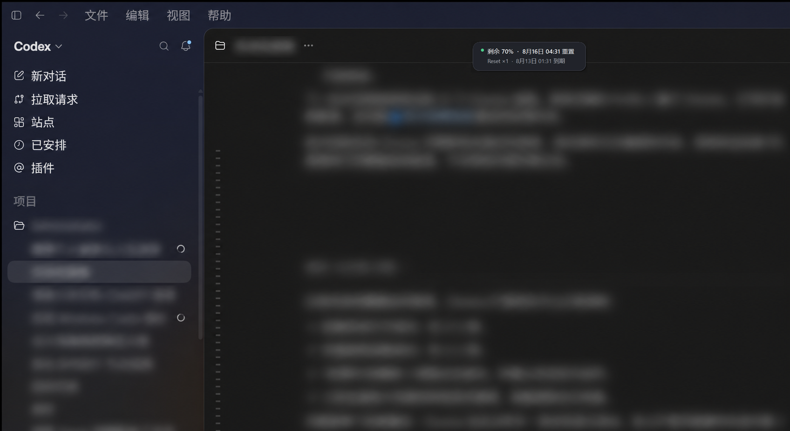

# Codex 额度悬浮层（Windows）

[](https://github.com/cpys/codex-quota-overlay/actions/workflows/ci.yml)
[](https://github.com/cpys/codex-quota-overlay/actions/workflows/codeql.yml)
[](https://github.com/cpys/codex-quota-overlay/releases)
[](LICENSE)

[项目主页](https://cpys.github.io/codex-quota-overlay/) · [English](README.md) · [下载](https://github.com/cpys/codex-quota-overlay/releases/tag/v0.4.0) · [隐私说明](PRIVACY.zh-CN.md) · [支持](SUPPORT.md)

Codex 额度悬浮层会把当前限制放在 Codex 会话标题旁，并把同一份本地数据整理成可操作的 Quota Center：消耗速度、预测、趋势、提醒和活跃度集中在一个界面。鼠标可穿透的悬浮条会在 Codex 离开前台时立即隐藏；仪表盘只在用户主动打开时出现。



截图保留了真实的 Codex 窗口和悬浮位置；与演示无关的工作区、会话和账户内容已经模糊处理。仓库不包含原始截图。

> [!IMPORTANT]
> 这是独立的社区开源项目，与 OpenAI 没有隶属、授权或支持关系。

## 功能

- 提供精简、标准、洞察三种悬浮条模式，可显示剩余额度、重置倒计时和近期消耗速度。
- 从托盘/菜单栏或双击图标打开本地 Quota Center。
- 展示服务返回的全部限制桶以及主要/次要周期，不再把多组限制悄悄压缩成一条。
- 根据本周期采样估算近期消耗速度、可持续到重置的安全速度、可能用尽时间和预测可信度。
- 本地 App Server 提供数据时，展示只读的 Codex 累计活跃度与近期每日用量。
- 默认只在本次运行内保留趋势；主动开启后可保存 7/14/30/90 天，落盘内容仅含规范化百分比和时间，可随时从仪表盘清空。
- 可在额度低于 10/20/30% 或预测会提前用尽时，每个限制周期提醒一次；提醒默认关闭。
- 服务返回 Reset 卡时，显示可用数量及每张卡的到期时间。
- 只在 Codex Desktop 位于前台时显示；切换应用、最小化或退出后立即隐藏。
- 不抢焦点，鼠标可穿透悬浮层继续操作 Codex。
- 支持高 DPI、多显示器、单实例和登录时自动启动。
- Windows 通知区域和 macOS 菜单栏提供刷新、位置微调、CLI 选择、短诊断码、隐私说明和退出。
- 使用 Codex 官方公开的本地 App Server `account/rateLimits/read` 与 `account/usage/read` 接口；不截图、不读取会话标题或浏览器 Cookie，也不会消耗 Reset 卡。
- 可选的匿名每日心跳默认未配置，只有用户主动开启后才会发送，详见[隐私说明](PRIVACY.zh-CN.md)。

## 支持范围

| 平台                    | 支持状态                                                       | 分发方式            |
| ----------------------- | -------------------------------------------------------------- | ------------------- |
| Windows 10/11 x64       | 已在 Windows 11 真机完成打包、安装、运行与卸载验证             | Setup EXE、便携 ZIP |
| macOS 12+ Apple Silicon | 在 GitHub 托管的 macOS 14 环境完成构建与包内自检；不是发布目标 | 仅源码/CI 验证      |
| macOS 12+ Intel         | 已验证通用原生辅助程序和 x64 包结构；不是发布目标              | 仅源码/CI 验证      |

0.4.0 仅分发 Windows 安装包。macOS 兼容代码和自动验证仍然保留，但 Release 不附带 macOS 安装包。

Linux 没有当前官方 Codex Desktop 应用，因此本项目不发布 Linux 安装包。Linux 用户可直接使用官方 Codex CLI。

使用 ChatGPT 托管账户登录的 Codex 才有对应的 ChatGPT 额度。仅 API Key 或其他账户配置可能没有可读取的额度信息。

## 安装

### Windows

1. 打开 [GitHub Releases](https://github.com/cpys/codex-quota-overlay/releases)。
2. 下载 `CodexQuotaOverlay-Windows-Setup-<版本>-x64.exe`。
3. 运行安装器；它可以直接升级旧的 0.1.x 版本。
4. 启动后，通知区域会出现应用图标。

也可以下载 `CodexQuotaOverlay-Windows-Portable-<版本>-x64.zip`，完整解压到固定目录后运行。

### macOS 兼容性

0.4.0 不分发 macOS 二进制。维护流程仍会在 GitHub 的 macOS 环境编译通用原生辅助程序、构建两个架构、校验 DMG 结构，并执行当前宿主架构的包内自检。开发者可使用下方源码构建说明。

> Windows 安装包当前没有商业代码签名。请只从本仓库下载，并使用 `SHA256SUMS-Windows-0.4.0.txt` 校验完整性。

## 使用与短诊断

保持应用在通知区域或菜单栏运行即可。选择 **打开 Quota Center…** 或双击图标进入完整仪表盘；悬浮条密度、提醒线和可选本地历史保留期都会即时保存。也可以通过 `CodexQuotaOverlay --dashboard` 直接打开仪表盘。

在托盘菜单或 Quota Center 中选择 **悬浮条主题 → 深色 / 浅色**。偏好保存在本地并即时生效，包括等待读取额度时；默认仍为深色。此设置仅影响悬浮条，不会自动跟随 Codex 或系统主题。

悬浮条的位置不合适时，用 **位置微调** 每次上下移动 2 px、左右移动 4 px，也可以恢复默认位置。

遇到问题时选择 **复制简短诊断信息**。复制内容最多 200 个字符，例如：

```text
E01 | 找不到 Codex CLI
```

诊断信息不会包含用户名、主机名、文件路径、账户、IP、安装 ID、会话标题、令牌或原始额度响应。0.2.0 起不写运行日志，也不提供长诊断文件导出。退出应用后，内存中的最后错误会随进程清除。

常见代码：

- `E01`：找不到 Codex CLI，可在菜单中手动选择。
- `E02`–`E05`：本地 App Server 启动、初始化、读取或退出错误。
- `W01` / `W02`：Codex 未打开、未位于前台或窗口身份未识别。
- `M01`：macOS 没有返回可用的 Codex 应用身份或窗口边界。

## 隐私

额度与活跃度数据始终留在本机。窗口探针只读取前台应用身份和窗口边界，并且主动把标题字段留空。应用不请求屏幕录制来截取内容，也不保存截图或会话信息。

额度历史默认仅存在于本次运行。只有用户主动开启持久化后，应用才会把规范化百分比、采样时间、重置时间、窗口时长和经过清洗的限制标识写入 `quota-history.json`；活跃度/Token 汇总不会写进这个文件。

设置文件位置：

- Windows：`%LOCALAPPDATA%\CodexQuotaOverlay\settings.json`
- macOS：`~/Library/Application Support/CodexQuotaOverlay/settings.json`

可选历史位于设置文件同目录的 `quota-history.json`，可以在 Quota Center 中清空。

完整字段说明见[隐私说明](PRIVACY.zh-CN.md)。

## 从源码构建

需要 Node.js 24 和 npm。

```powershell
npm ci
.\test.ps1
.\package.ps1
```

Windows 安装包还需要 Inno Setup 6。macOS DMG/ZIP 必须在 macOS 上生成：

```bash
npm ci
npm test
npm run dist:mac
```

推送标签后，GitHub Actions 会运行 Windows 正式打包和 macOS 兼容性验证；两端都成功后才创建 Release，但 Release 只包含 Windows 产物。

项目主页、CI、源码托管和安装包下载全部使用 GitHub Pages、Actions 与 Releases，不要求自定义域名或第三方云账户。公开构建中的可选统计服务仍保持未配置状态。

## 兼容性

额度来自官方文档中的 [`account/rateLimits/read`](https://learn.chatgpt.com/docs/app-server#rate-limits-chatgpt)，可选活跃度面板使用 `account/usage/read`。Codex 更新较快，两套解析器都会防御性处理缺失或新增字段。报告问题时只需提供悬浮层版本、Codex 版本和短诊断码，不要上传账户资料或长日志。

## 参与贡献与许可

欢迎提交 Issue 和 Pull Request。请先阅读 [CONTRIBUTING.md](CONTRIBUTING.md)、[CODE_OF_CONDUCT.md](CODE_OF_CONDUCT.md)、[SECURITY.md](SECURITY.md) 和 [GOVERNANCE.md](GOVERNANCE.md)。项目方向见 [ROADMAP.md](ROADMAP.md)，架构与发布资料位于 [docs](docs/ARCHITECTURE.md)。项目使用 [MIT License](LICENSE)。
