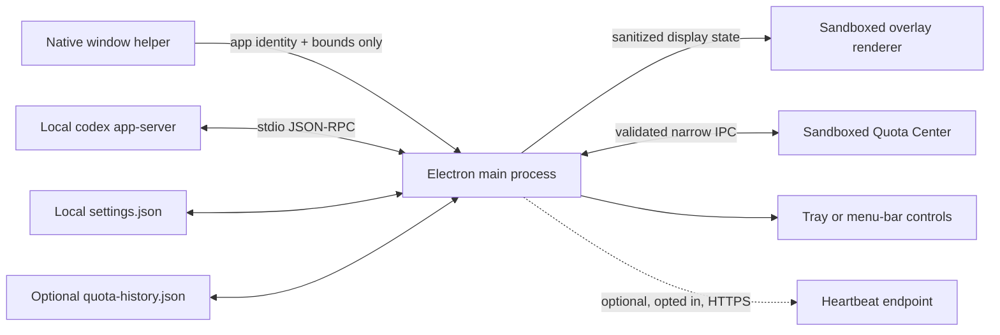

# Architecture

Codex Quota Overlay is a local-first Electron application with small native foreground-window helpers for Windows and macOS. It has two local renderer surfaces: a transparent click-through overlay for glanceable status and an on-demand Quota Center for analysis and preferences. There is no embedded web service or remote control plane.

## Runtime flow

1. Electron's per-user single-instance lock prevents duplicate overlays.
2. A native helper identifies the frontmost application and returns its identity and window bounds. It deliberately leaves the title empty.
3. When an official Codex Desktop window is active, the main process launches the locally installed `codex app-server` over stdio.
4. After JSON-RPC initialization, it calls `account/rateLimits/read`, accepts rate-limit update notifications, and periodically calls `account/usage/read` for optional aggregate activity data.
5. The responses are normalized into bounded quota buckets, usage summaries, and daily totals. Unknown fields are discarded.
6. Current-cycle quota samples feed burn-rate, safe-pace, exhaustion, and confidence calculations. Samples stay in memory unless the user explicitly enables bounded local history.
7. A non-activating, topmost, click-through overlay is positioned beside the Codex conversation title. It hides when Codex is inactive, minimized, or closed.
8. Quota Center is created only on request and receives normalized state through a dedicated preload bridge. It can update an allowlisted preference subset, request a refresh, copy the short diagnostic, or clear history.

## Process and trust boundaries

The Electron main process owns all filesystem, process, window, startup, notification, and network capabilities. The overlay receives only text, progress, status, mode, accent color, and locale. Quota Center receives normalized quota/history/usage state and exposes only five purpose-specific operations through a separate preload bridge.

Renderer protections include:

- Chromium sandboxing and context isolation;
- Node integration disabled;
- a `default-src 'none'` Content Security Policy;
- denied navigation and new-window creation;
- sender, WebContents, and frame-URL validation for overlay and dashboard IPC;
- explicit allowlisting and normalization of every renderer-controlled setting;
- no remote content.

Production packages use ASAR, embedded ASAR integrity validation, app-only-ASAR loading, disabled `ELECTRON_RUN_AS_NODE`, and disabled Node options/inspector flags. The local renderer uses Electron's `file:` handling only for files inside the integrity-checked application archive; its Content Security Policy blocks network access.

## Native helpers

- **Windows:** a small C# helper reads the foreground window, owning process identity, visibility/cloaking state, and bounds using Win32 APIs.
- **macOS:** a Swift helper reads the frontmost application identity and Accessibility window bounds. CI compiles and validates both x64 and arm64 slices.

Neither helper reads conversation titles, screen pixels, clipboard data, browser cookies, or Codex storage.

## Local state

`settings.json` may contain placement offsets, overlay mode, alert preferences, local-history preferences, a manually selected CLI path, telemetry consent, a random installation UUID, and the last heartbeat time.

Quota samples are session-only by default. When persistence is explicitly enabled, `quota-history.json` contains only sample time, normalized percentage, reset time, window duration, and a sanitized limit identifier. Retention is restricted to 7/14/30/90 days, unchanged points are compressed, future/expired points are pruned, and the store is capped at 2,000 samples. Writes use a temporary file followed by an atomic rename. Activity totals and daily token totals never enter this file.

Operational errors remain in process memory and can be copied only as a sanitized diagnostic capped at 200 characters. The current application writes no operational log.

## Telemetry boundary

Public source and release builds have no telemetry endpoint configured and send no heartbeat. If a future reviewed build supplies an HTTPS endpoint, the client still requires explicit user opt-in, sends at most one privacy-documented event per 24 hours, and backs off after failure. Quota data and Codex/account fields never cross this boundary. See [PRIVACY.md](../PRIVACY.md).

## Build and release

GitHub Actions runs the same lint, format, type, coverage, unit, host-simulation, and Electron smoke gates on pull requests. Windows jobs compile native helpers, create packages, run packaged/installed-app self-tests, and publish only from an immutable matching version tag. A macOS job keeps source, dual-architecture packaging, DMG structure, and the host-architecture self-test compatible without publishing macOS assets. Stable releases contain Windows checksums, a CycloneDX SBOM, and GitHub artifact attestations. See [RELEASING.md](RELEASING.md).
